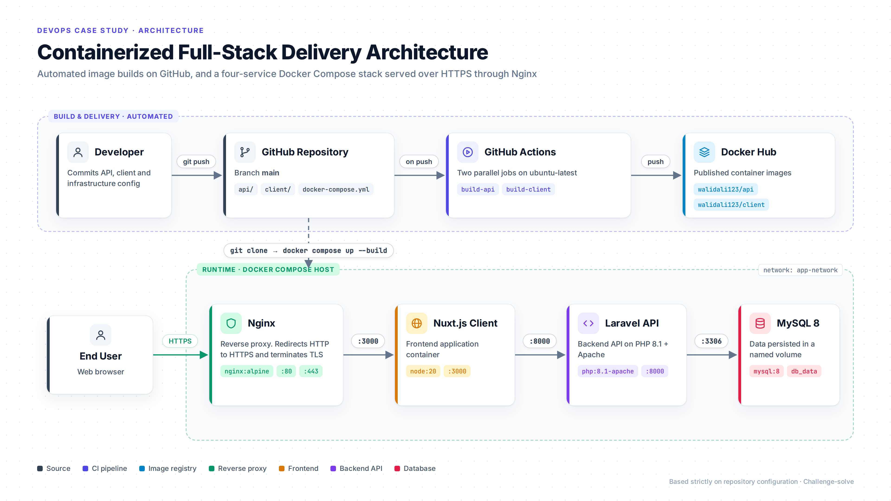
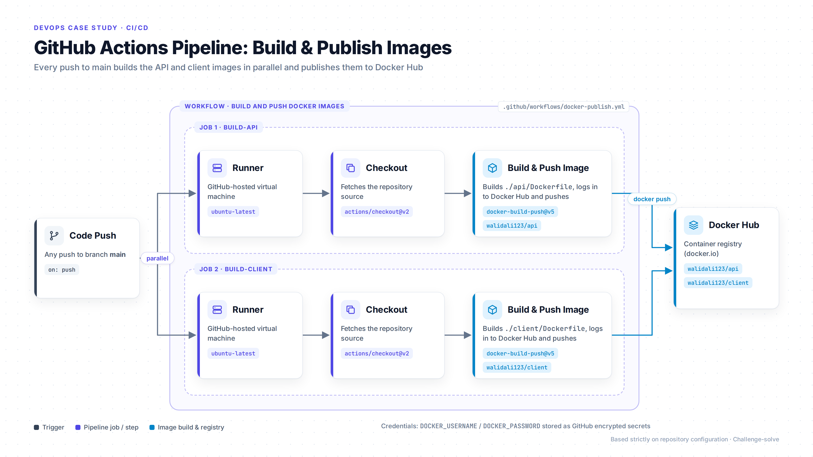
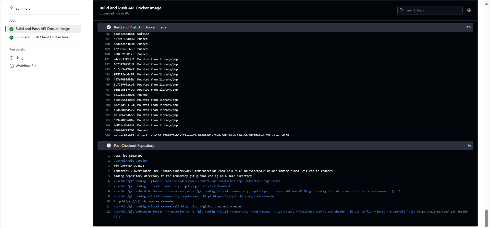
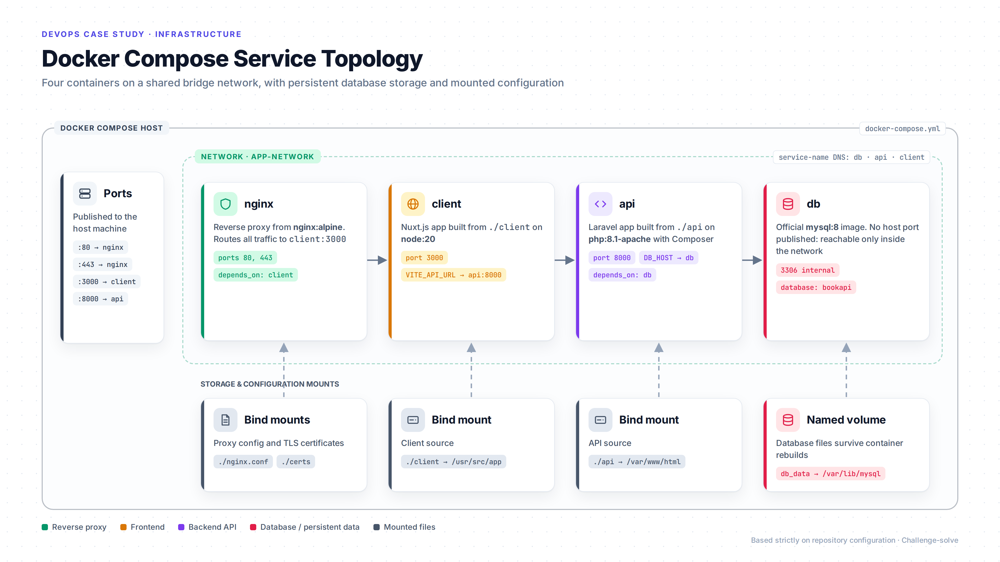
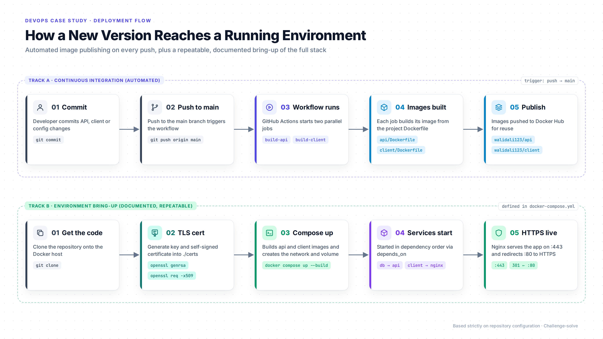
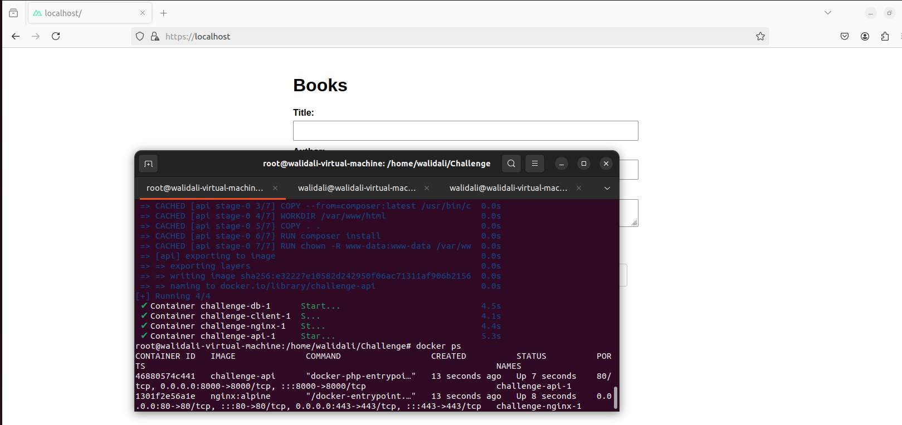
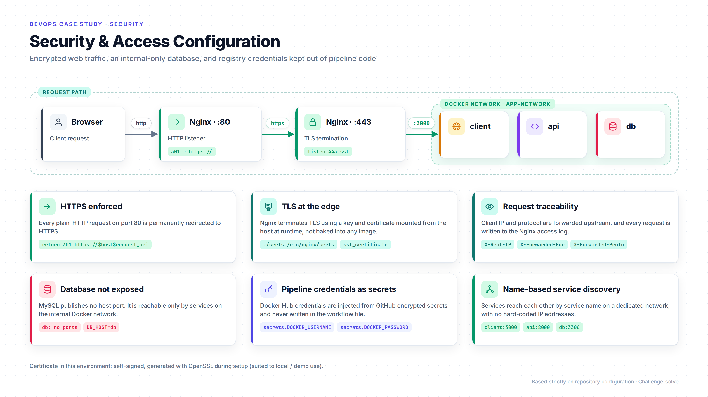

# DevOps Deployment & Infrastructure

**Containerized Full-Stack Deployment with Docker Compose, Nginx HTTPS & GitHub Actions**

Source repository: [github.com/walidali123/Challenge-solve](https://github.com/walidali123/Challenge-solve)

## Overview

This project packages a four-part web application (a Laravel API, a Nuxt.js frontend, a MySQL database and an Nginx reverse proxy) into a reproducible Docker Compose environment served over HTTPS. A GitHub Actions pipeline automatically builds the API and frontend container images on every push to `main` and publishes them to Docker Hub.

The scope of this work is the DevOps and deployment layer: containerization, service orchestration, reverse proxy and TLS configuration, and the CI pipeline. The environment was brought up and verified on an Ubuntu virtual machine.

## Architecture

The system has two parts. The **build and delivery** side runs in GitHub: a push to `main` triggers GitHub Actions, which builds both application images and publishes them to Docker Hub. The **runtime** side is a Docker Compose host where Nginx receives user traffic over HTTPS and proxies it to the Nuxt.js frontend, which works with the Laravel API, which in turn uses MySQL.

## CI/CD

The workflow (`.github/workflows/docker-publish.yml`) runs two independent jobs in parallel on GitHub-hosted `ubuntu-latest` runners. Each job checks out the repository, builds its image from the project's Dockerfile, authenticates to Docker Hub using GitHub encrypted secrets, and pushes the image (`walidali123/api` and `walidali123/client`).

*A successful pipeline run: both jobs completed and the API image was pushed to Docker Hub.*

## Infrastructure

All services are defined in a single `docker-compose.yml` and attached to a dedicated bridge network (`app-network`), where they reach each other by service name. The API and frontend are built from source (PHP 8.1 + Apache with Composer, and Node.js 20), while Nginx and MySQL use official images. Database files are stored in the named volume `db_data`, so data survives container rebuilds. The Nginx configuration and TLS certificates are mounted into the proxy container at runtime.

## Deployment Flow

A new version moves through two tracks. In the automated track, pushing to `main` builds and publishes fresh images. In the environment track, the full stack is brought up with a documented, repeatable procedure: clone the repository, generate a TLS certificate with OpenSSL, and run `docker compose up --build`. Compose creates the network and volume and starts services in dependency order (the database before the API, the frontend before Nginx).

*All four containers running, with the application served at `https://localhost`.*

## Security

Nginx listens on port 80 only to redirect to HTTPS, and terminates TLS on port 443. It forwards the client IP and protocol to the upstream service and records every request in its access log. The MySQL container publishes no port to the host, so it is reachable only from services inside the Docker network. Docker Hub credentials for the pipeline are stored as GitHub encrypted secrets rather than in the workflow file. The certificate in this environment is self-signed, which suits local and demo use.

## Technologies

Docker, Docker Compose, GitHub Actions, Docker Hub, Nginx, OpenSSL (TLS certificates), MySQL 8, Ubuntu Linux. Application runtimes containerized: PHP 8.1 with Apache and Composer (Laravel API), and Node.js 20 (Nuxt.js frontend).

## DevOps Responsibilities

- Wrote Dockerfiles for the Laravel API (PHP 8.1, Apache, PDO MySQL extensions, Composer) and the Nuxt.js frontend (Node.js 20 build and start).
- Designed a four-service Docker Compose stack with a dedicated network, service-name discovery, startup ordering and a persistent database volume.
- Configured Nginx as a reverse proxy with an HTTP-to-HTTPS redirect, TLS termination and forwarded client headers.
- Set up TLS certificate generation with OpenSSL and mounted certificates into the proxy at runtime.
- Built a GitHub Actions workflow that builds and publishes both application images to Docker Hub in parallel on every push to `main`.
- Managed registry credentials through GitHub encrypted secrets.
- Documented the setup and verification steps so the environment can be reproduced.

## Project Results

- The full stack starts on any Docker host with a single `docker compose up --build` command, following the documented steps.
- Every push to `main` automatically produces updated API and frontend images in Docker Hub, with no manual build or upload.
- All web traffic through Nginx is encrypted, with plain HTTP redirected to HTTPS.
- Database data persists across container restarts and rebuilds through a named volume.
- The pipeline and running stack were verified end to end, as shown in the screenshots above.
